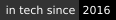

<a href="https://rahimbangla.com">
  
</a>

<p align="center">
  <a href="mailto:rahimbd623@gmail.com"></a>
  <a href="https://rahimbangla.com"></a>
  <a href="https://www.linkedin.com/in/abdurrahimbd/"></a>
  <a href="https://x.com/rahimbd623"></a>
  <a href="https://t.me/RahimBangla"></a>
</p>

<p align="center">
  
  
  
  
</p>

**Technical Lead at [HomePay LLC](https://homepay.io)**, in charge of an MFS Aggregator System for international remittance into mobile wallets.

I specialize in high-throughput C# and .NET microservices, Azure Functions and Kubernetes, shipped through modern CI/CD pipelines. Underneath the cloud work are deep infrastructure fundamentals: I started in 2016 as a founding network engineer at an ISP startup, and today I run secure peer-to-peer VPN partner integrations and self-hosted network environments.

---

## About

My first step was a small one. In 2011 I opened a Gmail account and made a Facebook profile, and I couldn't stop wondering how it all worked behind the screen. In 2012 I learned XHTML and put my first website live on Wapka, right from my phone. In 2013 I learned my first programming language, C, and in 2015 I went to Chittagong for my first national programming contest. That's where my journey in tech really began.

In 2016 I became a founding member and the network engineer of Roshni Communications, a new ISP in Cumilla, designing and running its network and operations center. Then I moved up the stack one step at a time, and in 2022, a few months into my CSE degree, I joined HomePay as a QA engineer. Today I'm the technical lead of the Mobile Wallet Remittance Aggregator, moving money from around the world into MFS wallets in Bangladesh.

Outside work I love traveling and exploring new places, so if you know somewhere worth seeing, say hi.

`2011` First Gmail and Facebook &nbsp;→&nbsp; `2012` First website &nbsp;→&nbsp; `2013` First program, in C &nbsp;→&nbsp; `2015` National programming contest &nbsp;→&nbsp; `2016` Founding member, ISP startup &nbsp;→&nbsp; `2022` Joined HomePay &nbsp;→&nbsp; `2025` Technical lead

<table>
  <tr>
    <td valign="top" width="50%">
      <b>Currently</b>
      <ul>
        <li>Leading the Mobile Wallet Remittance Aggregator at HomePay</li>
        <li>Building .NET microservices and serverless on Kubernetes in Azure</li>
        <li>Exploring AI-driven decentralized fintech</li>
      </ul>
    </td>
    <td valign="top" width="50%">
      <b>Education</b>
      <ul>
        <li>B.Sc. in CSE, Green University of Bangladesh <sub>(2021 – 2025)</sub></li>
        <li>HSC, Science, Dania College <sub>(2018 – 2020)</sub></li>
        <li>SSC, Science, Companigonj Badiul Alam High School <sub>(2013 – 2018)</sub></li>
      </ul>
    </td>
  </tr>
</table>

## Focus

| | |
|---|---|
| **AI-driven decentralized fintech** | Payment systems that use AI for fraud detection, risk scoring and smart transaction routing, on decentralized architectures with no single point of control. |
| **.NET and C#** | Microservices and APIs in ASP.NET Core, built for payment workloads. |
| **Kubernetes and serverless** | Containerized services on Kubernetes alongside event-driven Azure Functions, across the Azure ecosystem. |
| **DevOps and CI/CD** | Automated pipelines that build, test and deploy every service, from commit to production. |
| **Networking** | Peer-to-peer VPN connectivity between organizations and networking for self-hosted services, grounded in years of ISP work. |

## Selected work

### Mobile Wallet Remittance Aggregator `leading now`
Architecture and end-to-end delivery of an enterprise remittance aggregation platform connecting tier-1 global money transfer operators (MTOs) to a top-tier national mobile financial service (MFS) network in South Asia.<br>
`C#` `.NET microservices` `Azure` `Kubernetes` `Serverless` `CI/CD` `P2P VPN` · [homepay.io ↗](https://homepay.io)

### Blaze by HomePay `fintech`
The payment network connecting global remittances to local financial ecosystems. Remittance companies send payouts through one API, and the money lands in bank accounts and mobile wallets in Bangladesh, with settlement reports, webhooks and dispute handling for partners.<br>
`Remittance payouts` `Partner API` `Webhooks` `Settlement` · [homepay.io ↗](https://homepay.io)

### MutualCall `recent`
Premium pay-per-call platform connecting advertisers and publishers. I built the MutualCall console: a microservice backend on .NET 10 and a Vite + React front end, with real-time call routing, call tracking, analytics and reporting.<br>
`.NET 10` `C#` `React` `TypeScript` `Docker` · [Console ↗](https://console.mutualcall.com/) · [Live site ↗](https://mutualcall.com/)

| Project | What it is | Links |
|---|---|---|
| **Youth for Bangladesh** | Website and donation system for a volunteer youth nonprofit, plus its admin portal, the Valo Kajer Hotel free-meal site and YFBD EMS, an Android attendance app with selfie and GPS check-in. | [Site](https://yfbd.org/) · [Admin](https://admin.yfbd.org/) · [VKH](https://vkhbd.org/) · [App](https://play.google.com/store/apps/details?id=org.yfbd.ems&hl=en) |
| **CDR i2 Analyzer** | Browser tool for call detail records: map columns, explore calls as a link graph, filter, highlight and export. | [Live](https://rahimbangla.com/cdr/) · [Source](https://github.com/RahimBangla/cdr) |
| **Ollama Chat UI** | Browser chat interface for local LLMs running with Ollama, with image upload. | [Live](https://ollama-chat-ui.pages.dev/) · [Source](https://github.com/RahimBangla/ollama-chat-ui) |
| **ML Lab** | Machine-learning lab project served through a Django REST API with a React front end. | [Live](https://ml.yfbd.org/) · [Source](https://github.com/RahimBangla/ML-LAB-Project) |
| **Flicker Engineering** | Company website for a real estate consultancy, architecture and structural design firm. | [Live](https://www.flickerengineering.com/) · [Source](https://github.com/RahimBangla/flickerengineering.com) |
| **LocationApiBD** | Free JSON API of Bangladesh's divisions, districts, upazilas and unions, served from GitHub Pages. | [API](https://rahimbangla.com/LocationApiBD/) · [Source](https://github.com/RahimBangla/LocationApiBD) |

## Career path

```console
$ traceroute abdur-rahim
traceroute to homepay.io, 5 hops max
 1  roshnicommunication.net  2016–2018  Founding network engineer, Roshni Communications (ISP, NOC)
 2  bms-tech-logistics       2018–2019  Junior executive, IT, BMS-Tech-Logistics Ltd.
 3  yfbd.org                 2018–2022  IT executive (part-time), Youth for Bangladesh
 4  enteridea.com            2019       Assistant technical officer, Enter Idea (Market24.com)
 5  homepay.io               2022–now   HomePay LLC, Dhaka
      ├─ Technical lead               Jul 2025 – now
      ├─ Senior programmer            Jul 2023 – Jun 2025
      ├─ Software engineer            Apr 2022 – Jun 2023  (part-time)
      └─ Quality assurance engineer   Mar 2022 – Mar 2023  (part-time)
```

## Stack

<p>
  
</p>

<details>
<summary><b>Ranked by priority</b></summary>
<br>

| Languages | | Frameworks | | Technologies | |
|---|---|---|---|---|---|
| C# | `●●●●●●●●●●` | .NET Core | `●●●●●●●●●●` | Azure | `●●●●●●●●●●` |
| TypeScript | `●●●●●●●●●○` | Azure Functions | `●●●●●●●●○○` | Kubernetes | `●●●●●●●●●○` |
| JavaScript | `●●●●●●●●●○` | Node.js and Express | `●●●●●●●●○○` | Docker | `●●●●●●●●●○` |
| Python | `●●●●●●●○○○` | React | `●●●●●●●●○○` | CI/CD pipelines | `●●●●●●●●●○` |
| PHP | `●●●●●●●○○○` | Django and DRF | `●●●●●●●○○○` | Peer-to-peer VPN | `●●●●●●●●●○` |
| SQL | `●●●●●●●○○○` | Laravel | `●●●●●●○○○○` | Serverless | `●●●●●●●●○○` |
| Go | `●●●●●○○○○○` | Vue and Nuxt | `●●●●●●○○○○` | PostgreSQL | `●●●●●●●●○○` |
| Java | `●●●●○○○○○○` | NetSuite SuiteScript | `●●●●●○○○○○` | MikroTik | `●●●●●●●●○○` |
| C++ | `●●●●○○○○○○` | Angular | `●●●●○○○○○○` | Nginx | `●●●●●●●○○○` |
| Dart | `●●●○○○○○○○` | Flutter | `●●●●○○○○○○` | MySQL | `●●●●●●●○○○` |
| | | | | MongoDB | `●●●●●●○○○○` |
| | | | | Ollama and local LLMs | `●●●●●●○○○○` |
| | | | | AWS | `●●●●●○○○○○` |
| | | | | Google Cloud | `●●●●●○○○○○` |
| | | | | Firebase | `●●●●●○○○○○` |

Most of my C# and .NET work lives in private company repositories, so it doesn't show up in my public GitHub languages.

</details>

---

<p align="center">
  <b>Say hello.</b> I'm open to new roles, collaborations and interesting problems.<br>
  Email is the fastest way to reach me: <a href="mailto:rahimbd623@gmail.com">rahimbd623@gmail.com</a>
</p>
